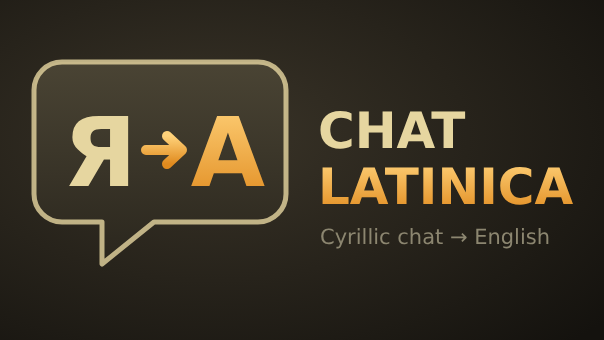
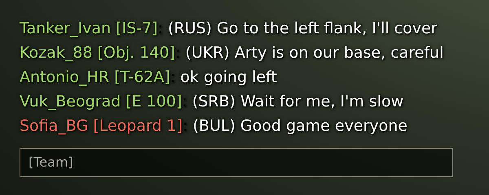

**Cyrillic World of Tanks chat, translated into English**

Messages in Russian, Ukrainian, Serbian, Bulgarian and other Cyrillic languages are shown in English, with the language in brackets. Works in battle, platoon, clan and private chat.

 Example

## Installation

1. Download the `.wotmod` from **[Releases](https://github.com/Bubl3Gum/ChatLatinica/releases/latest)**
2. Put it in `World_of_Tanks_EU\mods\2.4.1.0\` and delete any older version
3. Start the game

## Languages

`(RUS)` Russian · `(UKR)` Ukrainian · `(SRB)` Serbian · `(BUL)` Bulgarian · `(MKD)` Macedonian · `(BLR)` Belarusian · `(KAZ)` Kazakh · and more

## Good to know

- Translation by Google Translate. If it doesn't answer within 2.5 s, the message is shown in Latin letters instead.
- Only the text of Cyrillic messages is sent for translation – no names or account data.
